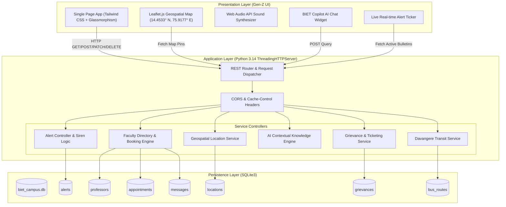
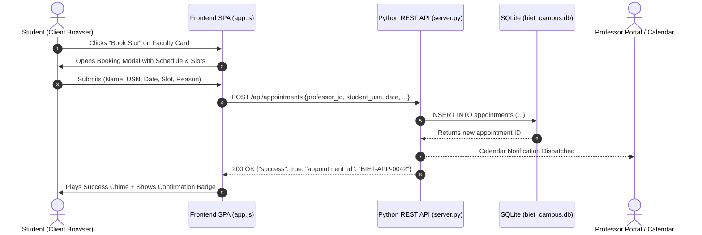
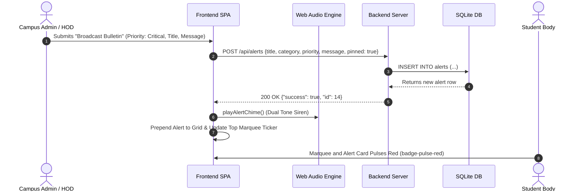
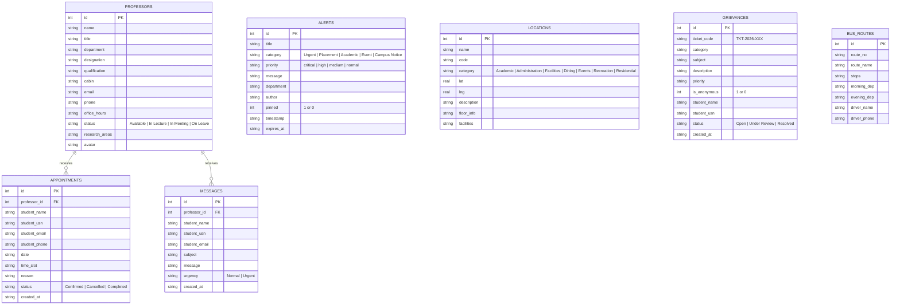

# 🏛️ BIET Davangere — Smart Campus 360 System Design & API Specification

> **Document Version**: 2.0.0  
> **Target Institute**: Bapuji Institute of Engineering and Technology (BIET), Davangere, Karnataka  
> **Status**: Production Architecture  
> **Author**: Antigravity System Architect  

---

## 1. System Vision & Overview

The **BIET Smart Campus 360 & Alert Hub** is an integrated full-stack campus management platform built specifically for **Bapuji Institute of Engineering and Technology (BIET), Davangere**. It unifies administrative communication, real-time alert dispatching, faculty-student interaction, campus geospatial navigation, and student welfare under a **Gen-Z aesthetic** (glassmorphism, neon accents, micro-interactions, audio chimes).

### Core Goals:
1. **Low-Latency Alert Broadcasting**: Instant distribution of emergency bulletins, VTU circulars, placement drives, and campus alerts.
2. **Transparent Faculty Availability**: Live occupancy status (Available, In Lecture, In Meeting, On Leave) and integrated office hour slot booking.
3. **Geospatial Campus Navigation**: 63-acre campus map with building pins, laboratory details, and floor plans.
4. **Autonomous AI Campus Copilot**: Dual-mode (Gen-Z & Professional) interactive campus assistant.
5. **Zero-Friction Zero-Dependency Deployment**: 100% Python standard library backend + embedded SQLite database.

---

## 2. High-Level System Architecture



---

## 3. Data Flow & Sequence Workflows

### 3.1 Office Hours Booking Workflow



### 3.2 Real-Time Alert Broadcast Workflow



---

## 4. Database Schema (Entity-Relationship)



---

## 5. Complete REST API Specification

### 5.1 Institute Overview

#### `GET /api/overview`
Retrieves institutional metadata, accreditations, bento statistics, and academic departments.

- **Request**: No parameters.
- **Response `200 OK`**:
```json
{
  "institute": {
    "name": "Bapuji Institute of Engineering and Technology",
    "short_name": "BIET Davangere",
    "motto": "Work is Worship (Kāyakavē Kailāsa)",
    "location": "Shamanur Shivashankarappa Marg, Hadadi Road, Davangere, Karnataka 577004",
    "established": 1979,
    "founder": "Dr. Shamanur Shivashankarappa",
    "management": "Bapuji Educational Association (BEA)",
    "principal": "Dr. K. S. Jayantha",
    "affiliation": "Visvesvaraya Technological University (VTU), Belagavi",
    "accreditation": [
      "NAAC 'A' Grade",
      "NBA Accredited Programs",
      "AICTE Approved",
      "NIRF Ranked Band"
    ],
    "coordinates": { "lat": 14.4533, "lng": 75.9177 }
  },
  "stats": {
    "years_of_excellence": 47,
    "campus_acres": 63,
    "students_enrolled": 4200,
    "faculty_members": 240,
    "doctorate_faculty": 85,
    "placement_rate": "92.4%",
    "top_recruiters": ["Bosch", "TCS", "Infosys", "Cisco", "Wipro", "L&T"]
  },
  "departments": [
    { "code": "CSE", "name": "Computer Science & Engineering", "students": 720, "hod": "Dr. Nirmala C. R." },
    { "code": "ISE", "name": "Information Science & Engineering", "students": 480, "hod": "Dr. Poornima B." },
    { "code": "AI&DS", "name": "Artificial Intelligence & Data Science", "students": 360, "hod": "Dr. Pradeep N." }
  ]
}
```

---

### 5.2 Alert Management System

#### `GET /api/alerts`
Retrieves active campus announcements sorted by pinned status descending, then creation time descending.

- **Query Parameters**:
  - `category` *(string, optional)*: Filter by category (`Urgent`, `Placement`, `Academic`, `Event`, `Campus Notice`, or `All`).
  - `search` *(string, optional)*: Substring match against `title`, `message`, or `department`.

- **Response `200 OK`**:
```json
{
  "alerts": [
    {
      "id": 1,
      "title": "🚨 CRITICAL: VTU Odd Semester Exam Schedule 2026-27 Released",
      "category": "Urgent",
      "priority": "critical",
      "message": "VTU timetable announced. Collect hall tickets before Friday.",
      "department": "All Departments",
      "author": "Office of the Principal",
      "pinned": 1,
      "timestamp": "2026-11-20 11:00"
    }
  ],
  "count": 1
}
```

#### `POST /api/alerts`
Broadcasts a new campus bulletin.

- **Request Headers**: `Content-Type: application/json`
- **Request Body**:
```json
{
  "title": "⚡ HackBIET 2026 Registration Open",
  "category": "Event",
  "priority": "high",
  "department": "Computer Science & Engg",
  "author": "Innovation Cell",
  "message": "36-hour national level hackathon with ₹2.5 Lakh prize pool.",
  "pinned": true
}
```
- **Response `200 OK`**:
```json
{
  "success": true,
  "id": 8,
  "message": "Alert broadcasted successfully!"
}
```

#### `PATCH /api/alerts/{id}/pin`
Toggles pinned state of an alert.

- **Response `200 OK`**: `{"success": true, "message": "Pin status updated"}`

#### `DELETE /api/alerts/{id}`
Deletes an alert from the board.

- **Response `200 OK`**: `{"success": true, "message": "Alert deleted successfully"}`

---

### 5.3 Faculty Directory & Office Hours

#### `GET /api/professors`
Returns faculty members with live cabin status and research areas.

- **Query Parameters**:
  - `department` *(string, optional)*: Filter by department keyword (e.g. `Computer Science`, `Civil`).
  - `status` *(string, optional)*: Filter by status (`Available`, `In Lecture`, `In Meeting`, `On Leave`).
  - `search` *(string, optional)*: Substring search across name, designation, cabin, and research areas.

- **Response `200 OK`**:
```json
{
  "professors": [
    {
      "id": 1,
      "name": "Dr. Nirmala C. R.",
      "title": "Professor & Head of Department",
      "department": "Computer Science & Engineering",
      "designation": "Professor & HOD",
      "qualification": "Ph.D (VTU), M.Tech (CSE), B.E",
      "cabin": "Block B - Room CS-201",
      "email": "hod_cse@bietdvg.edu",
      "phone": "+91 8192-223461 Ext: 201",
      "office_hours": "Mon-Fri: 02:00 PM - 04:00 PM",
      "status": "Available",
      "research_areas": "Artificial Intelligence, Machine Learning, Data Analytics",
      "avatar": "https://images.unsplash.com/photo-1573496359142-b8d87734a5a2?w=400"
    }
  ],
  "count": 1
}
```

#### `PATCH /api/professors/{id}/status`
Updates a professor's real-time availability status.

- **Request Body**: `{"status": "In Meeting"}`
- **Response `200 OK`**: `{"success": true, "message": "Professor status changed to In Meeting"}`

#### `POST /api/appointments`
Books an office hours consultation slot.

- **Request Body**:
```json
{
  "professor_id": 1,
  "student_name": "Arjun Rao",
  "student_usn": "4BD23CS012",
  "student_email": "arjun@bietdvg.edu",
  "student_phone": "+91 98450 12345",
  "date": "2026-11-25",
  "time_slot": "02:30 PM - 03:00 PM",
  "reason": "Final year capstone project review"
}
```
- **Response `200 OK`**:
```json
{
  "success": true,
  "appointment_id": "BIET-APP-0003",
  "message": "Office hours appointment booked and confirmed! Calendar notification sent to professor."
}
```

#### `POST /api/messages`
Dispatches a student doubt or query to the professor's official portal inbox.

- **Request Body**:
```json
{
  "professor_id": 1,
  "student_name": "Pooja Hegde",
  "student_usn": "4BD23CS088",
  "student_email": "pooja@bietdvg.edu",
  "subject": "Lab 4 Assignment Deadline Query",
  "message": "Can we submit the report as a Jupyter Notebook?",
  "urgency": "Normal"
}
```
- **Response `200 OK`**:
```json
{
  "success": true,
  "message": "Message dispatched directly to professor's official portal inbox."
}
```

---

### 5.4 Geospatial Campus Map

#### `GET /api/locations`
Returns campus building landmarks with GPS coordinates and facilities.

- **Response `200 OK`**:
```json
{
  "locations": [
    {
      "id": 1,
      "name": "Administrative Block & Principal's Office",
      "code": "ADM-01",
      "category": "Administration",
      "lat": 14.45330,
      "lng": 75.91770,
      "description": "Main administrative headquarters of BIET.",
      "floor_info": "Ground & 1st Floor",
      "facilities": "Principal Office, Registrar Desk, Accounts, Boardroom"
    },
    {
      "id": 2,
      "name": "Babbage Block (CS & IS Tech Complex)",
      "code": "TECH-CS",
      "category": "Academic",
      "lat": 14.45385,
      "lng": 75.91820,
      "description": "Hub for Computer Science, Information Science & AI/Data Science.",
      "floor_info": "4 Floors (G+3)",
      "facilities": "AI Innovation Lab, Cloud Lab, NVIDIA GPU Cluster"
    }
  ]
}
```

---

### 5.5 AI Campus Copilot

#### `POST /api/chatbot`
Processes contextual queries with dual personality modes (`genz` vs `pro`).

- **Request Body**:
```json
{
  "message": "Where is the canteen and what's good?",
  "mode": "genz"
}
```
- **Response `200 OK`**:
```json
{
  "reply": "The Canteen is an absolute culinary W! 🤤 You gotta hit the Dosa Corner for that legendary Davangere Benne Dosa + spicy coconut chutney. Hot filter coffee hits different during 11 AM break. Located right behind the Mechanical Block."
}
```

---

### 5.6 Student Grievance & Helpdesk

#### `POST /api/grievances`
Registers a student complaint or feedback ticket.

- **Request Body**:
```json
{
  "category": "Infrastructure",
  "subject": "Need extra monitors in AI Lab",
  "description": "Dual monitor setup required for multi-agent visualization models.",
  "is_anonymous": true,
  "priority": "Medium"
}
```
- **Response `200 OK`**:
```json
{
  "success": true,
  "ticket_code": "TKT-2026-784",
  "message": "Grievance ticket created! Action team notified."
}
```

#### `GET /api/grievances`
Returns the recent public resolution feed.

---

### 5.7 Transit & Emergency Dispatch

#### `GET /api/bus-routes`
Returns scheduled college transit routes across Davangere (City Railway Station, PB Road, MCC 'A'/'B' Block, Harihar, Jagalur) with driver names and phone numbers.

#### `GET /api/emergency`
Returns 24x7 emergency contacts for Campus Security (`+91 8192-223460`), Medical Clinic, Anti-Ragging Cell, Women Safety, Davangere South Police, and Bapuji Hospital Emergency (`108` / `08192-220000`).

---

## 6. Frontend Design Tokens & Gen-Z Aesthetic

| Token | Value | Semantic Usage |
|---|---|---|
| `--bg-dark` | `#0a0c14` | Global deep space backdrop |
| `--bg-card` | `rgba(18, 22, 37, 0.75)` | Glassmorphic bento cards with `backdrop-filter: blur(16px)` |
| `--accent-purple` | `#8B5CF6` | Primary brand accent & focus rings |
| `--accent-pink` | `#EC4899` | Secondary gradient stop & Hackathon badges |
| `--accent-cyan` | `#06B6D4` | Map coordinates, Tech blocks & AI Copilot |
| `--accent-rose` | `#F43F5E` | Critical alert pulses & SOS emergency buttons |
| `--accent-emerald` | `#10B981` | Online/Available status indicator pulses |
| `--accent-amber` | `#F59E0B` | In Lecture warning status & Transit buses |

---

## 7. Operational Runbook

### Starting the Server
```cmd
run.bat
```
or via terminal:
```powershell
& "$env:LOCALAPPDATA\Programs\Python\Python314\python.exe" server.py
```

### Server Verification
1. Access `http://localhost:8000` in any web browser.
2. Verify SQLite database auto-initialization at `data/biet_campus.db`.
3. Check status code: `curl -I http://localhost:8000/api/overview` (returns `200 OK`).
